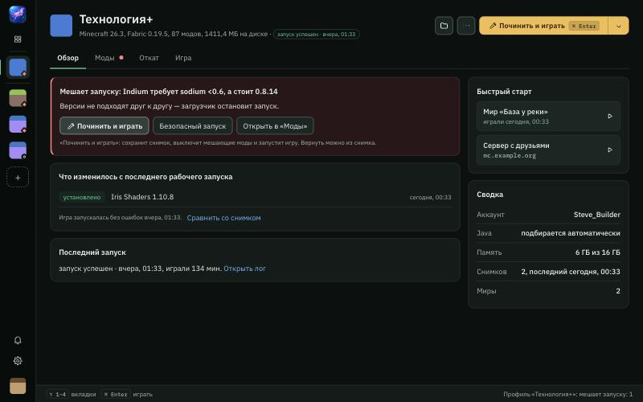

<div align="center">


# Axel'

**Лаунчер Minecraft: Java Edition для тех, у кого больше одной сборки.**

Профили не мешают друг другу, моды ставятся из Modrinth и CurseForge, а когда игра падает,
Axel' говорит, какой мод виноват, и предлагает починить. Открытый код, без рекламы и слежки.

<sub>An open-source Minecraft: Java Edition launcher for people with more than one modpack. Interface in Russian and English.</sub>

[](https://github.com/Hewako/axel-launcher/releases)
[](https://github.com/Hewako/axel-launcher/releases)
[](LICENSE)
[](https://github.com/Hewako/axel-launcher/issues)

<p>
<a href="https://github.com/Hewako/axel-launcher/releases"></a>
<a href="https://github.com/Hewako/axel-launcher/releases"></a>
<a href="https://github.com/Hewako/axel-launcher/releases"></a>
<a href="https://github.com/Hewako/axel-launcher/releases"></a>
<a href="https://github.com/Hewako/axel-launcher/releases"></a>
<a href="https://github.com/Hewako/axel-launcher/releases"></a>
</p>

<!-- До выхода 0.1.0 кнопки ведут на страницу релизов: ссылки releases/latest/download/… не видят пробные сборки.
     После 0.1.0 вернуть прямые ссылки на файлы (docs/RELEASE_CHECKLIST.md). -->
<p>
  <a href="https://github.com/Hewako/axel-launcher/releases"><picture><source media="(prefers-color-scheme: dark)" srcset="docs/img/download-windows-dark.png"></picture></a>
  <a href="https://github.com/Hewako/axel-launcher/releases"><picture><source media="(prefers-color-scheme: dark)" srcset="docs/img/download-macos-dark.png"></picture></a>
  <a href="#установка"><picture><source media="(prefers-color-scheme: dark)" srcset="docs/img/download-linux-dark.png"></picture></a>
</p>

[Что умеет](#что-умеет) · [Установка](#установка) · [Вопросы](#вопросы) · [Что пока не так](#что-пока-не-так) · [Помочь проекту](#помочь-проекту) · [Что нового](CHANGELOG.md)



</div>

## Что умеет

**Профили, которые не ломают друг друга.** У каждого профиля свои моды, миры, Java и память.
Vanilla, Fabric, Quilt, Forge или NeoForge и любая версия из официального списка Mojang, включая 26.x.
Нужная Java скачается сама, и Axel' объяснит, почему выбрал именно её.

**Моды и сборки в пару кликов.** Каталоги Modrinth и CurseForge прямо в лаунчере, импорт
`.mrpack` и zip-сборок, экспорт своей сборки в `.mrpack`. Обновление модов с предпросмотром:
видно, что поменяется, до того как поменялось.

**Mod Doctor.** Проверяет сборку до запуска и находит несовместимые моды, пока игра не упала.
Если всё-таки упала — разбирает краш, называет виновника и предлагает «Починить и играть».
Не понятно, кто виноват? «Найти виновника краша» выключает моды по половинам — обычно хватает
3–6 запусков.

**Откат и бэкапы.** Перед каждым изменением модов Axel' делает снимок профиля — вернуться можно
в один клик. Миры бэкапятся сами перед рискованным запуском, а если мир сохранён в более новой
версии игры, Axel' предупредит и тоже сделает бэкап.

**Когда что-то пошло не так.** История 20 последних запусков каждого профиля с итогом словами:
«Без ошибок, 2 ч 14 мин» или «Падение через 11 с». Логи без токенов, домашней папки и IP —
можно смело отправить в чат поддержки. Отчёт для поддержки собирается одной кнопкой.

**Мелочи, которые экономят время.** Сравнение двух профилей, перенос модов и настроек из одного
в другой, вкладки «Конфиги», «Ресурсы» и «Серверы», папку игры можно унести на другой диск.
Клавиатура, светлая и тёмная тема, режим стримера, проверка доступности по WCAG 2.1 AA.

**Вход.** Microsoft с проверкой, что игра куплена (приложение одобрено Mojang). Ely.by — вместе
с Microsoft-аккаунтом. Токены лежат только в системном хранилище паролей, не в файлах.

## Установка

Все версии, включая пробные сборки, лежат на [странице релизов](https://github.com/Hewako/axel-launcher/releases).
Миры, профили и настройки хранятся отдельно, в папке `.axel` в домашней папке: обновление и
удаление программы их не трогают.

Установщики пока не подписаны платным сертификатом, поэтому при первом запуске система
предупредит, что не знает автора. Это ожидаемо — ниже, как пройти дальше.

<details open>
<summary><b>Windows 10 и 11</b></summary>

1. Скачайте `Axel-Launcher-Windows.exe` и запустите.
2. Если появится «Система Windows защитила ваш компьютер» — «Подробнее» → «Выполнить в любом случае».
3. Выберите язык и нажмите «Установить». Пароль администратора не нужен: программа ставится в
   вашу папку, ярлыки появятся на рабочем столе и в «Пуске». Если в системе нет WebView2,
   установщик скачает его сам.

Без установки: распакуйте `Axel-Launcher-Windows-portable.zip` куда угодно и запустите
`Axel Launcher.exe`. На Windows 10 может понадобиться WebView2 — ссылка в `README-portable.txt`
внутри архива.
</details>

<details>
<summary><b>macOS 11 и новее</b> — один файл для Apple Silicon и Intel</summary>

1. Откройте `Axel-Launcher-macOS.dmg` и перетащите Axel' в «Программы».
2. Запустите. macOS скажет, что не может проверить приложение, — нажмите «Готово».
3. «Системные настройки → Конфиденциальность и безопасность», внизу строка про Axel' →
   «Всё равно открыть», подтвердите паролем или Touch ID. Дальше Axel' открывается как обычно.

На macOS 14 и старше проще: правый клик по Axel' в «Программах» → «Открыть».
</details>

<details>
<summary><b>Linux</b> — x86-64, Ubuntu 22.04, Debian 12, Fedora 38 и новее</summary>

- Ubuntu, Debian, Mint: `sudo apt install ./Axel-Launcher-Linux.deb`
- Fedora, openSUSE: `sudo dnf install ./Axel-Launcher-Linux.rpm`
- Любой другой: `chmod +x Axel-Launcher-Linux.AppImage` и запустите. На Ubuntu 22.04 и новее
  AppImage нужна библиотека FUSE 2: `sudo apt install libfuse2` (на 24.04 — `libfuse2t64`).

Для входа нужно системное хранилище паролей — GNOME Keyring или KWallet.
</details>

<details>
<summary><b>Обновление, удаление и проверка файла</b></summary>

**Обновление.** Когда выходит новая версия, внизу окна появляется лента с кнопкой «Скачать» —
она скачает установщик для вашей системы. Поставьте его поверх, старую версию удалять не нужно.
Автоматически Axel' ничего не обновляет.

**Удаление.** Windows — «Параметры → Приложения»; macOS — перетащить из «Программ» в Корзину;
Linux — `sudo apt remove axel-launcher`, `sudo dnf remove axel-launcher` или просто удалить
AppImage. Миры и профили останутся в `.axel` (`%USERPROFILE%\.axel` на Windows) — если они
больше не нужны, удалите и эту папку.

**Файл не подменён?** В каждом релизе есть `SHA256SUMS.txt`. На macOS и Linux в папке со
скачанным файлом: `shasum -a 256 -c SHA256SUMS.txt --ignore-missing`. На Windows:
`Get-FileHash <файл>` в PowerShell и сравните со строкой в `SHA256SUMS.txt`.
</details>

## Вопросы

<details>
<summary><b>Это бесплатно?</b></summary>

Да, и без рекламы. Axel' — открытый проект под GPL-3.0.
</details>

<details>
<summary><b>Нужна купленная игра?</b></summary>

Да. Axel' запускает Minecraft только с аккаунтом Microsoft, на котором игра куплена, — как
официальный лаунчер.
</details>

<details>
<summary><b>Куда уходят мои данные?</b></summary>

Axel' не собирает статистику и ничего не отправляет разработчику. Он обращается только к
сервисам входа, игры, Java и модов и к GitHub — узнать о новой версии. Полный список —
в [docs/PRIVACY.md](docs/PRIVACY.md).
</details>

<details>
<summary><b>Можно перенести сборки из другого лаунчера?</b></summary>

Да: Axel' импортирует инстансы Prism Launcher и MultiMC, сборки `.mrpack` и zip-сборки
CurseForge, а папку официального лаунчера подхватывает без копирования.
</details>

<details>
<summary><b>Почему Windows и macOS ругаются при установке?</b></summary>

Установщики не подписаны платным сертификатом разработчика.
Файлы собираются автоматически на GitHub из открытого кода, а суммы в `SHA256SUMS.txt`
помогут проверить, что файл никто не подменил.
</details>

## Что пока не так

- **Forge** — для Minecraft 1.17 и новее; старые версии вроде 1.12.2 и 1.16.5 пока нет.
- **Windows и Linux** проверены автоматикой и пробными сборками; вручную каждый релиз
  проходит на macOS.
- **macOS, Minecraft 1.13–1.17.1** без модов не открывает окно (ошибка самой игры MCL-15163).
  Для Fabric 1.14–1.17.1 Mod Doctor предложит мод-исправление.
- **Каталог CurseForge** есть только в официальных сборках (нужен ключ API); zip-сборки
  CurseForge импортируются везде.
- **Ely.by** работает только вместе с Microsoft-аккаунтом, на котором куплена игра.

Нашли ошибку — [расскажите о ней](https://github.com/Hewako/axel-launcher/issues/new). Лучше всего с отчётом из
«Логи и краши → Отчёт для поддержки».

## Помочь проекту

Самая полезная помощь — сообщить об ошибке или о том, что неудобно: [задачи](https://github.com/Hewako/axel-launcher/issues).
Хотите поправить код — добро пожаловать, пулреквесты читаем.


<details>
<summary><b>Собрать из исходников</b></summary>

Нужны Rust (stable) и Node.js 20+.

```bash
cd ui && npm ci && npm run tauri dev
```

Сборка разработчика, разрешающая запуск без входа (только debug, для проверки на своей копии игры):

```bash
cd ui && npm run tauri dev -- --features dev-launch
```

Командная строка:

```bash
cargo run -p axel-core --bin axel -- --help
```

Тесты: `cargo test --workspace` (сетевые помечены `#[ignore]`: `cargo test -- --ignored`).

```
core/   ядро axel-core и CLI axel, без зависимости от интерфейса
ui/     интерфейс Tauri 2 + React; ui/src-tauri — тонкие команды над ядром
docs/   журнал работы, решения, инструкции
```

Как описывать изменения — [docs/COMMITS.md](docs/COMMITS.md), журнал работы —
[docs/PROGRESS.md](docs/PROGRESS.md), как выпускается релиз — [docs/RELEASE_CHECKLIST.md](docs/RELEASE_CHECKLIST.md).
Установщики собирает GitHub Actions по тегу `v*`.
</details>

---

<div align="center">
<sub>
Axel' — открытый проект под <a href="LICENSE">GPL-3.0-or-later</a>.
Не связан с Mojang и Microsoft. Minecraft — товарный знак Mojang AB.
</sub>
</div>
